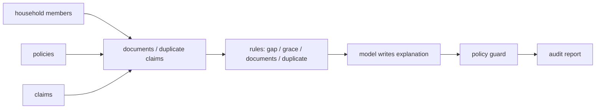

# Cover · family policies

[](https://github.com/wushiyi105-jpg/cover/actions)

[](./LICENSE)


Who is under-insured, which policy is in its grace period, and which claim is missing a document.

## Features

- Compares sum insured against 10× income for life, 3× for critical illness, 5× for accident and a 300k medical floor.
- Warns 15 days before expiry, treats 60 days after expiry as a grace period, then as lapsed.
- Checks the three claim documents (diagnosis, invoice, itemised costs) and flags duplicate claims on one policy.
- Drops any clause citation whose number and text do not match the stored clause.

Rules live in `cover/domain/rules/`; the CLI and the web layer only call them. The Chinese README lists every `rule_id` with its penalty.

## Quickstart

```bash
pip install -e ".[dev]"
python -m cover seed
python -m cover audit --day 2026-11-27
python -m cover renew --day 2026-11-27
python -m cover serve        # http://127.0.0.1:8004
```

Run `python -m cover --help` for the full command list; `docker build -t cover . && docker run -p 8004:8004 cover` works the same way.

## Why not just ask a general LLM

The hard part of policies is not the premium but whether cover is enough and whether it lapsed. Cover turns both into arithmetic and restricts model commentary to cited clauses.

## When to use it

- You do an annual family policy review.
- A claim needs a document checklist before submission.

## Roadmap

- OCR policy documents to fill clause numbers.
- Track claims through to settlement.

## FAQ

**Can it replace underwriting?**
No. The multiples are a general rule of thumb.

**Where do clause texts come from?**
You store them; citations without a matching clause are removed.

**Was the Docker image verified?**
Docker is not installed on the build machine, so `docker build .` was not run and the image is unverified; only the Dockerfile and ports were checked statically.

## Commands

See the Chinese README (`README.md`) for the command table with flags; every command supports `--help`.

## Dependencies

FastAPI + Uvicorn, Jinja2, pydantic / pydantic-settings, httpx, Typer + Rich, SQLAlchemy + Alembic; dev extras add pytest, pytest-cov, respx, freezegun, ruff, mypy, pip-audit. Version pinning lives in `uv.lock`.

## How it works



## Layout

```
cover/
├── .github/
│   ├── ISSUE_TEMPLATE
│   ├── PULL_REQUEST_TEMPLATE.md
│   └── workflows
├── assets/
│   └── demo.gif
├── cover/
│   └── … 9 项
├── data/
│   ├── cover.db
│   └── seed.json
├── migrations/
│   ├── __init__.py
│   ├── env.py
│   ├── script.py.mako
│   └── versions
├── prompts/
│   └── terms.md
├── templates/
│   └── index.html
├── tests/
│   ├── __init__.py
│   ├── conftest.py
│   ├── test_grace_claims.py
│   ├── test_guard_engine.py
│   ├── test_needs.py
│   └── test_web_cli.py
├── CHANGELOG.md
├── CODE_OF_CONDUCT.md
├── CONTRIBUTING.md
├── Dockerfile
├── LICENSE
├── README.en.md
├── README.md
├── SECURITY.md
├── alembic.ini
├── pyproject.toml
```

## Author

Xiaomi · GitHub [@wushiyi105-jpg](https://github.com/wushiyi105-jpg) · 17612850106
