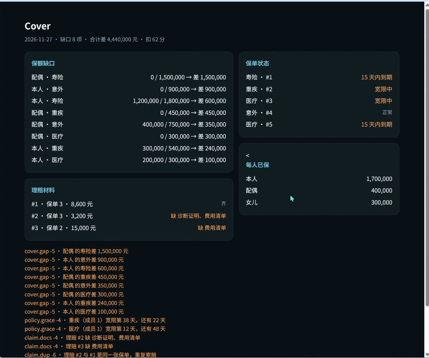

# Cover

[](https://github.com/wushiyi105-jpg/cover/actions)



Household insurance audit: coverage gaps, grace periods, claim paperwork.

## Run

```bash
pip install -e ".[dev]"
python -m cover seed
python -m cover audit --day 2026-11-27
python -m cover serve
```

## Author

shiyi · GitHub [@wushiyi105-jpg](https://github.com/wushiyi105-jpg) · wushiyi105@gmail.com
