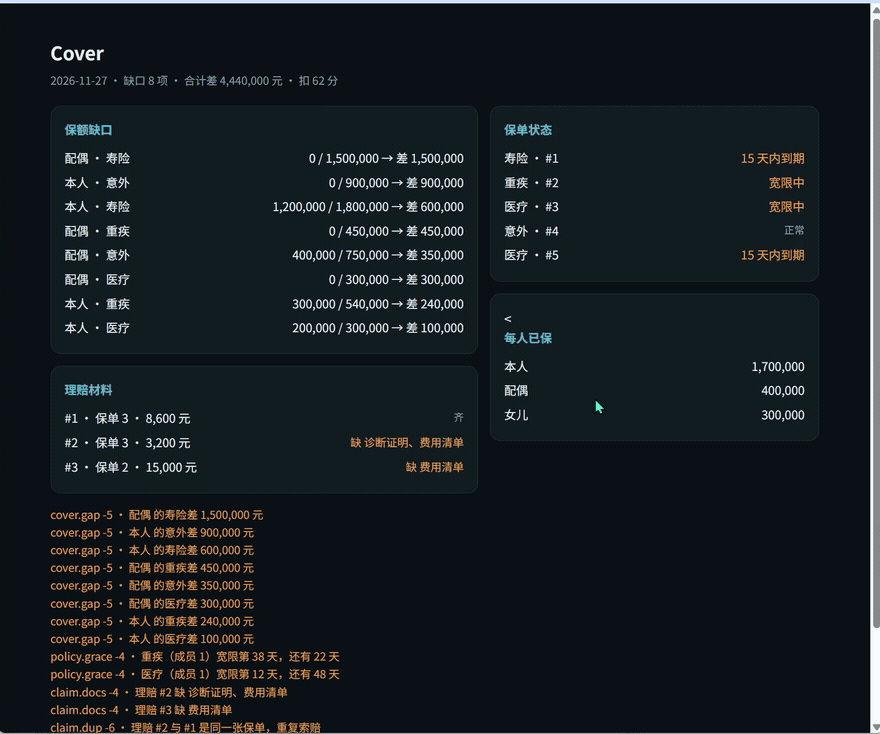
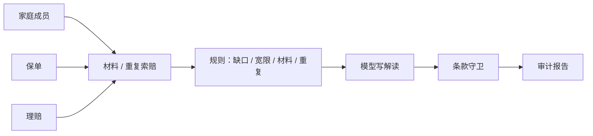

# Cover · 家庭保单

[](https://github.com/wushiyi105-jpg/cover/actions)

[](./LICENSE)



一家人的保单摊开：谁缺多少保额、哪张进了宽限期、理赔材料缺哪张。


## 功能特性

1. **保额缺口**：按倍数与定额算建议，逐人逐险种比差额。
2. **宽限期**：到期前 15 天提示，逾期 60 天内算宽限，超过判失效。
3. **理赔材料**：诊断证明、发票、费用清单三件套缺项列出。
4. **重复索赔**：同一张保单两条索赔直接报。
5. **条款守卫**：引条款不给号、或号对不上原文，整句丢弃。

### 规则与扣分

| rule_id | 含义 | 扣分 |
| --- | --- | --- |
| `cover.gap` | 某险种保额低于建议 | 5 |
| `policy.grace` | 进入 60 天宽限期 | 4 |
| `policy.lapsed` | 超过宽限期已失效 | 12 |
| `claim.docs` | 理赔材料缺项 | 4 |
| `claim.dup` | 同保单重复索赔 | 6 |
| `guard.terms` | 条款号与原文对不上 | 8 |

## 快速开始

```bash
pip install -e ".[dev]"
python -m cover seed
python -m cover audit --day 2026-11-27
python -m cover renew --day 2026-11-27
python -m cover serve        # http://127.0.0.1:8004
```

真实种子：3 人（本人年收入 18 万、配偶 15 万、女儿 0）、5 张保单、3 条理赔。
以 2026-11-27 跑 `audit`：8 项缺口合计 4,440,000 元，最大一档是配偶寿险差 150 万；
重疾那张宽限第 38 天、医疗那张宽限第 12 天；两条理赔各缺材料，且 #2 与 #1 撞同一张保单。
扣分 62（8×5 缺口 + 2×4 宽限 + 2×4 材料 + 6 重复索赔）。

## 为什么不用通用大模型直接问

保单的麻烦不在保费，在「够不够」和「有没有断」。寿险按年收入 10 倍、重疾 3 倍、意外 5 倍、医疗按 30 万定额，
和已买的保额一比，缺口就是数字；到期后 60 天宽限期，过了就失效；理赔三件材料缺一件就打回。
模型可以写解读，但引条款必须把条款号和原文一起带上，对不上就删。

## 适用场景

- 一年一次的家庭保单盘点，想知道每个人的保额够不够。
- 有保单过了到期日，想确认还在不在宽限期。
- 要报理赔，先核对材料齐不齐。

### 边界

- 保额倍数只是通用口径，不替代核保结论；
- 不计算免赔额与赔付比例；
- 不做产品推荐。

## Roadmap

- 保单拍照 OCR 录入，省掉手抄条款号。
- 保额建议按城市与收入分档，而不是统一倍数。
- 理赔进度跟踪到结案。

## FAQ

**能替代核保结论吗？**
不能，倍数只是通用口径，真正买什么要核保。

**条款原文从哪来？**
自己录；模型引条款必须带条款号和原文，对不上就删。

**宽限期怎么算？**
到期后 60 天，超过判失效。

**Docker 镜像验证了吗？**
CI 的 `docker` job 每次执行 `docker build .`，启动容器并轮询 `/health`；本机没有 Docker，本地未重复跑。

## 命令参考

| 命令 | 作用 | 常用参数 |
| --- | --- | --- |
| `seed` | 写入成员、保单、理赔。 | --db |
| `audit` | 缺口、宽限、材料。 | --day, --db |
| `renew` | 30 天内到期或刚过期的保单。 | --day, --db |
| `explain` | 模型解读（无 key 时不编）。 | --db |
| `doctor` | 四项体检。 | --db |
| `serve` | Web 界面。 | --port, --db |

全部命令都支持 `--help`；只读命令不带参数时读默认库 `data/cover.db`，写命令用 `--db` 指到别的库。

## 依赖说明

| 依赖 | 为什么装 | 不装会怎样 |
| --- | --- | --- |
| `fastapi` + `uvicorn[standard]` | Web 入口与 ASGI 服务 | 只有命令行，没有页面 |
| `jinja2` | 服务端渲染模板 | 页面出不来 |
| `pydantic` + `pydantic-settings` | 配置与数据结构校验，`.env` 直接生效 | 配置散在代码里，改端口要改源码 |
| `httpx` | 调模型与 webhook 的 HTTP 客户端 | 模型层与推送都不可用 |
| `typer` + `rich` | 命令行与终端表格 | 只能用 curl 调接口 |
| `sqlalchemy` + `alembic` | 本地库与迁移 | 表结构变更只能删库重来 |
| `pytest` / `pytest-cov` / `respx` / `freezegun`（dev） | 单测、覆盖率、HTTP 打桩、冻结时间 | 规则改动没有回归保护 |
| `ruff` / `mypy` / `pip-audit`（dev） | 风格、类型、依赖漏洞检查 | CI 只看测试，类型错误会漏进主干 |

装了 `uv` 的话，`uv sync --extra dev` 会按 `uv.lock` 装同一套版本。

## 工作原理




domain 里是保额缺口、宽限期、理赔材料与条款守卫；app 负责审计。

## 目录结构

```
cover/
├── .github/
│   ├── ISSUE_TEMPLATE
│   ├── PULL_REQUEST_TEMPLATE.md
│   └── workflows
├── assets/
│   └── demo.gif
├── cover/
│   └── … 9 项
├── data/
│   ├── cover.db
│   └── seed.json
├── migrations/
│   ├── __init__.py
│   ├── env.py
│   ├── script.py.mako
│   └── versions
├── prompts/
│   └── terms.md
├── templates/
│   └── index.html
├── tests/
│   ├── __init__.py
│   ├── conftest.py
│   ├── test_grace_claims.py
│   ├── test_guard_engine.py
│   ├── test_needs.py
│   └── test_web_cli.py
├── CHANGELOG.md
├── CODE_OF_CONDUCT.md
├── CONTRIBUTING.md
├── Dockerfile
├── LICENSE
├── README.en.md
├── README.md
├── SECURITY.md
├── alembic.ini
├── pyproject.toml
```

## 质量与供应链

- CI 的 Coverage 步骤带 `--fail-under=70`，覆盖率低于 70% 直接失败。
- `tests/test_app_fake.py` 用真实 `InMemoryStore` 跑主用例，并显式标注 `StorePort` 交给 mypy 做结构校验；测试不创建 SQLite 文件。
- Audit 步骤从 `uv.lock` 导出运行时依赖，再用 `pip-audit -r` 审计；开发工具链不进发布物，运行时依赖有漏洞就让 job 失败，不用 `|| true` 吞错。

## 容器验证

镜像由 CI 的 docker job 构建并探活验证；本机未装 Docker。

## 作者

小米 · GitHub [@wushiyi105-jpg](https://github.com/wushiyi105-jpg) · 17612850106